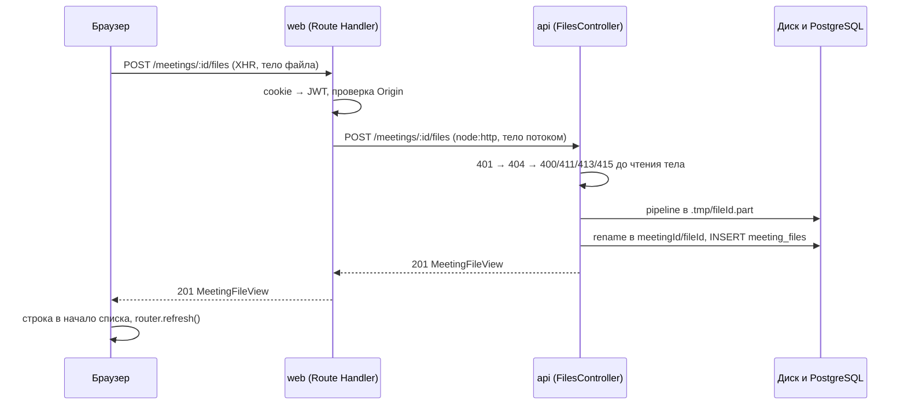

# Research: Загрузка файлов встречи

**PRD:** [docs/prd-meeting-file-upload.md](prd-meeting-file-upload.md)

**План:** [docs/plan-meeting-file-upload.md](plan-meeting-file-upload.md)

**Дата:** 2026-11-07

**Проверено на версиях:** Next.js 16.4.3, React 19.3, NestJS 12.2 (Express 5.3), Node.js 24.21 (встроенный undici 7.29.1), Prisma 7.10, HeroUI 3.2.6, react-aria-components 1.22.1.

## Итог

План опирается на верную схему: браузер → Route Handler web → api → локальный диск, тело файла всё время идёт потоком. Исследование её подтверждает и уточняет технологию на каждом звене. Главные выводы:

1. **Протокол — «сырое» тело, один `POST` на файл.** `Content-Type: application/octet-stream`, имя в заголовке `X-File-Name` (UTF-8 через `encodeURIComponent`), размер — обязательный `Content-Length`. Без multipart, multer и tus: так api отказывает по размеру до чтения тела, а web пробрасывает тело, не разбирая его.
2. **Прокси загрузки в web — `node:http` + `pipeline`, а не `fetch`.** Замер на 1 ГиБ: с `fetch` RSS процесса Next вырастает на ~1 ГБ даже при работающем backpressure, с `node:http` — на 117–126 МБ. Критерий плана «память растёт не более чем на 256 МБ» выполним только во втором варианте.
3. **Скачивание и просмотр в web — `fetch` с пробросом `Range`.** Замер: +53…125 МБ на 1 ГиБ, ответ 206 и `Content-Range` проходят без изменений. `apiFetch` здесь нельзя: его `AbortSignal.timeout(10_000)` обрывает и тело ответа.
4. **Файловые Route Handler должны быть вне `matcher` proxy.** Проверено: proxy клонирует тело и обрезает его до 10 МиБ ещё до вызова функции, даже если она пропускает все не-GET. `matcher` страницы встречи — строго `'/meetings/:id'`, без `:path*`. Проброс `Content-Length` в api превращает такую ошибку конфигурации из тихой порчи файла в явный обрыв.
5. **Приём в api — `pipeline(req, проверка, createWriteStream)` во временный файл, затем `rename` и запись в БД.** Замер: +41…47 МБ на 1 ГиБ, обрыв удаляет `.part`. Проверки до чтения тела: 401 → 404 → 400/411/413/415.
6. **Отдача в api — `res.download()` и `res.sendFile()` из Express 5.** Они уже умеют Range, 206/416, `ETag` и `Content-Disposition` с `filename*` для кириллицы. `StreamableFile` из Nest не поддерживает Range, а `FileTypeValidator` требует файл целиком в памяти: оба не подходят.
7. **Таймаут Node 300 с обрывает загрузку дольше 5 минут** (проверено: 408 посреди тела). 1 ГиБ укладывается в 5 минут только при исходящем канале от ~29 Мбит/с. В api таймаут поднимается одной строкой, а `next start` такой настройки не даёт — нужно решение (раздел 7).
8. **Клиент — XHR, очередь на 3 параллельные загрузки, проверка до отправки.** Прогресса отправки у `fetch` по-прежнему нет. Зона загрузки — `DropZone` и `FileTrigger` из react-aria-components (на них построен HeroUI v3), прогресс — `ProgressBar` HeroUI.
9. **Удаление — Server Action**, как остальные мутации в web: встроенная проверка `Origin` и `refresh()`. Route Handler нужны только там, где идут байты файла.
10. **Память мерить на свежем процессе.** RSS после пика не возвращается к исходному значению, поэтому замеры подряд на одном процессе искажают рост. Методика — в разделе 9.

## Как проводилось исследование

- Прочитаны PRD, план, `apps/*/CLAUDE.md` и текущий код api и web.
- Поведение установленных версий проверено по документации и исходникам в `node_modules` (список в «Источниках»): Next.js, NestJS, Express 5, `send`, multer 2.5, react-aria-components, HeroUI.
- Спорные места проверены на прототипе во временном каталоге вне репозитория: минимальное приложение на установленном Next 16.4.3 (`next build --webpack`, `next start`) с Route Handler загрузки и скачивания, заглушка api на Node 24 и приёмник с записью на диск, устроенный как предлагаемый контроллер api. Файл — 1 ГиБ случайных байт, RSS снимался каждые 100 мс, каждый сценарий шёл на свежем процессе. Прототип удалён, код репозитория не менялся.
- Внешние источники использованы только для того, что нельзя проверить локально: браузеры и Playwright.

## Результаты замеров

Размер файла — 1 ГиБ, если не указано иное. RSS свежего процесса до загрузки: Next ≈ 105 МБ, Node-заглушки ≈ 61 МБ.

| #   | Сценарий                                                                                                  | Результат                                                                                                                                                                                                            |
| --- | --------------------------------------------------------------------------------------------------------- | -------------------------------------------------------------------------------------------------------------------------------------------------------------------------------------------------------------------- |
| 1   | web: Route Handler вне `matcher` отправляет тело через `fetch(…, { body: request.body, duplex: 'half' })` | SHA-256 и `Content-Length` дошли без изменений; пик RSS **+1008…1084 МБ**                                                                                                                                            |
| 2   | то же, но upstream читает медленно (~26 МБ/с, 41 с)                                                       | клиент замедлился вместе с upstream, то есть backpressure работает; пик RSS всё равно **+903…979 МБ**; после GC `arrayBuffers` = 0                                                                                   |
| 3   | то же в чистом Node 24 без Next (`fetch(url, { body: req })`)                                             | пик ≈ +1,1 ГБ: это поведение undici, а не Next; `--max-semi-space-size=1` снижает до ~+800 МБ, но не решает; для сравнения `http.request` + `pipeline` в чистом Node — +80 МБ                                        |
| 4   | web: Route Handler на `node:http` + `pipeline(Readable.fromWeb(request.body), …)`                         | пик RSS **+117…126 МБ** на полной скорости и **+26 МБ** при медленном upstream; SHA-256 совпал                                                                                                                       |
| 5   | web: скачивание через Route Handler на `fetch` → `new Response(upstream.body)`                            | пик RSS **+125 МБ** на полной скорости и **+53 МБ** при клиенте 25 МБ/с; SHA-256 совпал                                                                                                                              |
| 6   | web: `Range: bytes=1000-1999` через Route Handler                                                         | `206`, `Content-Range: bytes 1000-1999/1073741824`, `Content-Length: 1000`, `Accept-Ranges: bytes`                                                                                                                   |
| 7   | web: путь из `matcher` proxy (функция сразу возвращает `next()`), 50 МиБ                                  | тело обрезано на 10 МиБ, в логе предупреждение, клиенту ошибка не пришла; благодаря проброшенному `Content-Length` undici бросил `UND_ERR_REQ_CONTENT_LENGTH_MISMATCH`, и upstream получил обрыв, а не короткий файл |
| 8   | web: клиент обрывает загрузку на первой секунде                                                           | upstream видит `aborted` примерно через секунду и с `fetch`, и с `node:http`                                                                                                                                         |
| 9   | web: gzip                                                                                                 | ответы Route Handler (`text/plain` 30 МБ, JSON) не сжимаются, HTML-страницы сжимаются                                                                                                                                |
| 10  | приёмник как в api: `pipeline(req, Transform, createWriteStream)` → `rename`                              | пик RSS **+41…47 МБ**; обрыв клиента → `.part` удалён; `Content-Length: 1 ГиБ + 1` с телом в 10 байт → мгновенный `413` с `Connection: close`                                                                        |
| 11  | Node 24: `server.requestTimeout`                                                                          | по умолчанию 300 000 мс; при 2 000 мс активно идущая загрузка оборвана с `408` через ~2,1 с; `next start` значение не меняет; повышение после `createServer` действует                                               |
| 12  | Node `fetch` с потоковым телом и явным `content-length`                                                   | запрос уходит с `Content-Length`, не chunked; несовпадение длины → `UND_ERR_REQ_CONTENT_LENGTH_MISMATCH`; `abort()` → upstream видит `aborted`                                                                       |

Почему `fetch` «съедает» гигабайт, хотя ничего не копит. При медленном upstream клиент замедлился до его скорости (41 с вместо 1 с): очереди нет. После загрузки и принудительного GC `arrayBuffers` возвращается к нулю: утечки нет. Но undici на каждом звене копирует чанк в новый `Uint8Array`, а сборщик мусора освобождает эти буферы медленнее, чем они появляются, и RSS успевает дорасти до размера файла. `node:http` передаёт исходные `Buffer` без копий, и проблема исчезает. Прототип собирался webpack, а приложение — Turbopack; запрос в обоих случаях обрабатывает общий код `next/dist/server`, но замер стоит повторить в фазе 4 на `npm start`.

## Сквозная схема



| Операция      | web                                                                                         | api                                                               |
| ------------- | ------------------------------------------------------------------------------------------- | ----------------------------------------------------------------- |
| Список файлов | Server Component, `apiFetch`                                                                | `GET /meetings/:id/files`                                         |
| Загрузка      | XHR → Route Handler `POST /meetings/[id]/files` (`node:http`)                               | `POST /meetings/:id/files`                                        |
| Скачивание    | `<a href>` → Route Handler `GET /meetings/[id]/files/[fileId]` (`fetch`)                    | `GET /meetings/:id/files/:fileId` (`res.download`)                |
| Просмотр      | `<video>`, `<audio>`, ``, PDF → Route Handler `GET …/[fileId]/view` (`fetch`, `Range`) | `GET /meetings/:id/files/:fileId/view` (`res.sendFile`, `inline`) |
| Удаление      | Server Action, `apiFetch`, `refresh()`                                                      | `DELETE /meetings/:id/files/:fileId`                              |

## 1. Протокол загрузки

|                                 | «Сырое» тело (рекомендую)                    | multipart + multer (`FileInterceptor`)                                                                               | tus (`@tus/server`, Uppy)                                                        |
| ------------------------------- | -------------------------------------------- | -------------------------------------------------------------------------------------------------------------------- | -------------------------------------------------------------------------------- |
| Поток без накопления в памяти   | да, `pipeline`                               | да, `diskStorage`                                                                                                    | да                                                                               |
| Отказ по размеру до чтения тела | точный: `Content-Length` равен размеру файла | неточный: в `Content-Length` входит разметка multipart, а `limits.fileSize` срабатывает, когда гигабайт уже прочитан | да, `Upload-Length`                                                              |
| Имя с кириллицей                | `X-File-Name` + `decodeURIComponent`         | busboy по умолчанию читает имя как `latin1`, нужен `defParamCharset: 'utf8'`                                         | метаданные в base64                                                              |
| Проверка формата по содержимому | первые 12 байт, до записи остального         | только после записи: `FileTypeValidator` работает лишь с `memoryStorage`                                             | хук на сервере                                                                   |
| Проброс через web               | тело как есть                                | тело как есть, без разбора                                                                                           | `POST`, `PATCH`, `HEAD`, `DELETE` и заголовки протокола                          |
| Обрыв                           | `.part` удаляется сразу                      | multer 2.5 удаляет частичный файл                                                                                    | частичная загрузка ждёт докачки до истечения срока — противоречит «нет остатков» |
| Докачка                         | нет (вне скоупа PRD)                         | нет                                                                                                                  | да                                                                               |

tus стоит вернуть в рассмотрение вместе с докачкой или если загрузки дольше 5 минут станут обязательными (раздел 7). Прямая загрузка в хранилище по подписанной ссылке (S3) вне скоупа PRD.

Контракт одинаков для браузер → web и web → api:

- `POST /meetings/:id/files`.
- `Content-Type: application/octet-stream`; на любой другой api отвечает 415. Иначе глобальные `express.json()` и `express.urlencoded()` Nest могут прочитать тело раньше контроллера.
- `Content-Length` обязателен, без него 411. `XMLHttpRequest` с `File` и `curl -T` выставляют его сами.
- `X-File-Name: encodeURIComponent(file.name)`. Заголовки HTTP передаются в latin1, поэтому UTF-8 кодируется. В URL имя не кладётся, чтобы оно не попадало в логи доступа.

Ответы: 201 с `MeetingFileView` (`{ id, name, size, mimeType, createdAt }`) и `Location`; 400 (нет имени, недопустимое имя, пустой файл), 401, 404, 411, 413 (больше 1 ГиБ), 415 (формат по расширению или по сигнатуре, чужой `Content-Type`), по желанию 507 (нет места на диске).

## 2. api: приём файла

### Модуль и CQRS

Отдельный модуль `files` (`src/files`): контроллер на путях `/meetings/:meetingId/files`, сообщения `CreateMeetingFileCommand`, `ListMeetingFilesQuery`, `GetMeetingFileQuery`, `DeleteMeetingFileCommand` и сервис диска `FileStorage`. Доступ к встрече проверяется через шину сообщением `GetMeetingQuery` модуля `meetings`: зависимость `files → meetings`, таблицу `meetings` модуль `files` не читает. По правилам `apps/api/CLAUDE.md` сообщение, результат которого читает другой модуль, наследует `Query<MeetingView>`.

Одно отступление от правил CQRS нужно записать в `apps/api/CLAUDE.md`: тело запроса — поток, а сообщения содержат только примитивы. Поэтому поток принимают контроллер и `FileStorage` (транспорт и инфраструктура), а в шину уходят примитивы: `GetMeetingQuery` до чтения тела и `CreateMeetingFileCommand(ownerId, meetingId, fileId, name, mimeType, size)` после `rename`. Если команда упала, контроллер удаляет уже переименованный файл.

### Порядок проверок

1. `JwtAuthGuard` — 401.
2. `GetMeetingQuery` — 404 для чужой и несуществующей встречи.
3. Заголовки: 415 (`Content-Type`), 400 (имя), 411, 400 (`Content-Length: 0`), 413 (больше 1 ГиБ), 415 (расширение не из списка).
4. Только после этого чтение тела.

Ответы шагов 1–3 уходят с `Connection: close`: фильтр исключений на контроллере загрузки ставит заголовок, если `req.complete === false`. Без него Node после ответа дочитывает и выбрасывает остаток тела, и клиент без токена отправил бы гигабайт впустую. В прототипе `413` на заявленный 1 ГиБ + 1 байт пришёл сразу.

### Запись на диск

```ts
const tmpPath = join(this.dir, '.tmp', `${fileId}.part`);
try {
  await pipeline(
    source,
    inspector,
    createWriteStream(tmpPath, { flags: 'wx' }),
  );
  await mkdir(join(this.dir, meetingId), { recursive: true });
  await rename(tmpPath, join(this.dir, meetingId, fileId));
} catch (error) {
  await rm(tmpPath, { force: true });
  throw error;
}
```

- `fileId = randomUUID()` генерирует api. Имя на диске никогда не берётся от клиента: нет path traversal и проблем с кодировками.
- `inspector` — `Transform`, который считает байты (страховка поверх `Content-Length`) и сверяет первые 12 байт с сигнатурой формата. Ошибка в нём рвёт `pipeline`, и `catch` удаляет `.part`.
- После `pipeline` число байт сравнивается с `Content-Length`. При обрыве клиента `pipeline` сам отклоняется с `ECONNRESET`.
- `flags: 'wx'` защищает от перезаписи. По желанию `flush: true` (fsync при закрытии), чтобы запись в БД не опередила данные на диске при сбое питания.
- `.tmp` лежит внутри каталога хранения: `rename` атомарен только в пределах одной файловой системы.
- При старте api удаляет всё из `.tmp`: незавершённых загрузок в этот момент нет, а остатки могли появиться только от падения процесса.

### Имя файла

`decodeURIComponent` → `normalize('NFC')` → `trim()`. Отказ 400, если имя пустое, длиннее 255 символов или содержит управляющие символы (CR, LF и прочие `\p{Cc}`). NFC важен: macOS отдаёт имена в NFD, и «й» и «ё» иначе хранились бы двумя кодовыми точками. Имя хранится только в БД и уходит в `Content-Disposition`.

### Форматы и сигнатуры

Единый источник — таблица в api, её зеркало — в web, как `validation.ts` зеркалит `RegisterDto`. Тип для отдачи берётся из таблицы, а не от клиента.

| Расширение      | MIME, который отдаёт api    | «Смотреть» | Сигнатура в первых 12 байтах                                                 |
| --------------- | --------------------------- | ---------- | ---------------------------------------------------------------------------- |
| `.mp4`          | `video/mp4`                 | да         | `ftyp` со смещения 4                                                         |
| `.webm`         | `video/webm`                | да         | `1A 45 DF A3`                                                                |
| `.mov`          | `video/quicktime`           | да         | атом QuickTime со смещения 4: `ftyp`, `moov`, `mdat`, `free`, `wide`, `skip` |
| `.mp3`          | `audio/mpeg`                | да         | `ID3` или заголовок кадра: `FF`, затем байт со старшими битами `111`         |
| `.m4a`          | `audio/mp4`                 | да         | `ftyp` со смещения 4                                                         |
| `.wav`          | `audio/wav`                 | да         | `RIFF`, `WAVE` со смещения 8                                                 |
| `.ogg`          | `audio/ogg`                 | да         | `OggS`                                                                       |
| `.pdf`          | `application/pdf`           | да         | `%PDF-`                                                                      |
| `.docx`         | OOXML, см. ниже             | нет        | `PK 03 04` (ZIP)                                                             |
| `.pptx`         | OOXML, см. ниже             | нет        | `PK 03 04` (ZIP)                                                             |
| `.xlsx`         | OOXML, см. ниже             | нет        | `PK 03 04` (ZIP)                                                             |
| `.txt`          | `text/plain; charset=utf-8` | нет        | нет, принимается любое содержимое                                            |
| `.png`          | `image/png`                 | да         | `89 50 4E 47 0D 0A 1A 0A`                                                    |
| `.jpg`, `.jpeg` | `image/jpeg`                | да         | `FF D8 FF`                                                                   |
| `.webp`         | `image/webp`                | да         | `RIFF`, `WEBP` со смещения 8                                                 |
| `.gif`          | `image/gif`                 | да         | `GIF87a` или `GIF89a`                                                        |

OOXML: `application/vnd.openxmlformats-officedocument.wordprocessingml.document` (DOCX), `…presentationml.presentation` (PPTX), `…spreadsheetml.sheet` (XLSX).

Пакет `file-type` не нужен: он ESM-only, а для DOCX, PPTX и XLSX ему нужно больше первых байт. Таблица из 16 строк проще и одинаково работает в api и в браузере, где первые байты читает `file.slice(0, 12).arrayBuffer()`. MOV проверяется мягко: старые файлы начинаются не с `ftyp`, а с другого атома QuickTime.

### Лимит и свободное место

- 1 ГБ = 1 ГиБ = 1 073 741 824 байт — одна константа в api и в web.
- По желанию перед записью вызывать `fs.statfs(FILES_DIR)` и отвечать 507, если свободного места меньше `Content-Length` плюс запас (например, 2 ГиБ). Том Docker с PostgreSQL обычно лежит на том же диске, и переполнение остановит и базу. README в любом случае описывает ручной контроль (`df -h`, `du -sh`).

### Таймауты

`requestTimeout` HTTP-сервера (по умолчанию 300 с, раздел 7) поднять, например, до часа. Делать это в `onApplicationBootstrap` модуля `files` через `HttpAdapterHost`: так настройка действует и в e2e, где `main.ts` не участвует. Проверено, что повышение после создания сервера действует; `headersTimeout` (60 с) должен оставаться не больше `requestTimeout`. Зависшую загрузку вместо общего срока отсекает таймаут простоя: `req.setTimeout(60_000, …)` в контроллере загрузки рвёт соединение, если байты не приходят минуту, и `.part` удаляется.

## 3. api: хранение и модель данных

### Каталог

- `FILES_DIR` из корневого `.env` (с шаблоном в `.env.example`), по умолчанию `apps/api/storage`. Абсолютный путь вычисляется от `import.meta.url`, как путь к `.env` в `configuration.ts`, а не от текущего каталога процесса.
- Структура: `<FILES_DIR>/<meetingId>/<fileId>` и `<FILES_DIR>/.tmp/<fileId>.part`.
- Каталог добавляется в `.gitignore` до первой загрузки. Иначе он попадёт в `git status`, в хэш задач turbo (`$TURBO_DEFAULT$` учитывает неигнорируемые файлы пакета) и под проверку Stop-хука.
- `FILES_DIR` из `.env` api читает само. Чтобы задавать его из shell при запуске через turbo, переменную нужно добавить в `globalPassThroughEnv`.
- e2e-тестам можно дать отдельный каталог через `test.env` в `vitest.config.e2e.ts`, например в `os.tmpdir()`: файлы тестовых пользователей не будут копиться рядом с файлами разработки. План сейчас оставляет их в общем каталоге, оба варианта рабочие.

### Модель Prisma

```prisma
model MeetingFile {
  id           String   @id
  meetingId    String   @map("meeting_id")
  meeting      Meeting  @relation(fields: [meetingId], references: [id], onDelete: Cascade)
  originalName String   @map("original_name")
  mimeType     String   @map("mime_type")
  size         BigInt
  createdAt    DateTime @default(now()) @map("created_at")

  @@index([meetingId, createdAt(sort: Desc)])
  @@map("meeting_files")
}
```

- `id` без `@default`: его генерирует api до записи, он же имя файла на диске.
- `size BigInt`. `Int` (int4) вмещает 1 ГиБ, но не больше 2 ГиБ, а переход int4 → int8 позже переписывает всю таблицу. Prisma возвращает `bigint`, который `JSON.stringify` не сериализует, поэтому view превращает его в `number` (точно до 2^53).
- `createdAt` — момент записи в БД, то есть окончания загрузки. Это и есть «дата загрузки».
- Сортировка списка — `createdAt desc, id desc`: второй ключ делает порядок детерминированным, если две записи попали в одну миллисекунду.
- `onDelete: Cascade` повторяет текущую схему, но удаление встречи или пользователя оставит файлы на диске сиротами. Сценариев удаления сейчас нет, при их появлении понадобится очистка каталога `<meetingId>`.

### Согласованность диска и БД

- Загрузка: сначала `rename`, потом `INSERT`. Падение между ними оставит файл без записи — мусор, который пользователь не видит. Обратный порядок дал бы запись без файла, то есть сломанную строку в списке.
- Удаление: сначала `DELETE` из БД (файл сразу пропадает из списка и отвечает 404), потом `unlink`. Ошибка `unlink` только логируется. Потоки, уже открытые на чтение, на macOS и Linux дочитают файл и после удаления.

## 4. api: отдача, Range, просмотр, удаление

```ts
@Get(':fileId')
async download(
  @CurrentUser() user: AuthUser,
  @Param('meetingId') meetingId: string,
  @Param('fileId') fileId: string,
  @Res() res: Response,
) {
  const file = await this.queryBus.execute(
    new GetMeetingFileQuery(user.id, meetingId, fileId),
  );
  res.download(file.path, file.name, {
    cacheControl: false,
    headers: {
      'Content-Type': file.mimeType,
      'Cache-Control': 'private, no-cache',
      'X-Content-Type-Options': 'nosniff',
    },
  });
}
```

- Express 5 через `send` сам отвечает 206 и 416 на `Range`, учитывает `If-Range`, ставит `ETag`, `Last-Modified`, `Accept-Ranges` и `Content-Disposition: attachment; filename="…"; filename*=UTF-8''…`. `Content-Type` из `headers` не перезаписывается: `send` выводит тип из расширения, только если заголовка ещё нет, а у файла на диске расширения нет.
- Просмотр (фаза 7) — `res.sendFile(path, …)` с `Content-Disposition` из пакета `content-disposition` (`create(name, { type: 'inline' })`). Пакет уже стоит как зависимость Express и содержит свои типы, но в `dependencies` api его нужно добавить явно. `res.download` для просмотра не годится: он игнорирует `Content-Disposition` из `options.headers`. `inline` отдаётся только форматам с «Смотреть» из таблицы, остальные — как вложение.
- `Cache-Control: private, no-cache` — браузер кэширует только с ревалидацией по `ETag`, файлы приватные.
- `@Res()` выводит ответ из-под интерсепторов Nest. Ошибки `res.download` приходят в его callback: файла нет на диске → 404, обрыв клиента (`ECONNABORTED`) игнорировать. Исключения до вызова (`GetMeetingFileQuery` → 404) по-прежнему обрабатывает фильтр Nest.
- `StreamableFile` не подходит: Express-адаптер Nest делает для него обычный `pipe` без Range, и видео не перематывалось бы.
- `DELETE /meetings/:id/files/:fileId` → `DeleteMeetingFileCommand` → 204; чужой или несуществующий файл — 404.

## 5. web: Route Handler

### Пути и proxy

Route Handler повторяют пути api (таблица в «Сквозной схеме»), и проксирование сводится к подстановке JWT. Список (Server Component) и удаление (Server Action) идут через `apiFetch`, как сейчас встречи.

Правило для `src/proxy.ts`: в `matcher` добавляется ровно `'/meetings/:id'`. Он совпадает с одним сегментом и не захватывает `/meetings/:id/files/…`. Шаблон `'/meetings/:path*'` сломает загрузку: Next клонирует тело для proxy (`getCloneableBody` → `cloneBodyStream`) ещё до вызова функции, поэтому ранний `return NextResponse.next()` для не-GET не спасает. Тело обрезается на 10 МиБ (`experimental.proxyClientMaxBodySize`), в лог пишется предупреждение, а клиенту ошибка не приходит. Увеличивать `proxyClientMaxBodySize` до 1 ГиБ нельзя: proxy держит клон тела в памяти.

Route Handler вне `matcher` проверяют сессию сами: GET отвечает `redirect('/login')`, POST от XHR — 401 JSON, и клиент сам переходит на `/login`.

### Загрузка: `node:http`, а не `fetch`

```ts
import { request as httpRequest, type IncomingMessage } from 'node:http';
import { Readable } from 'node:stream';
import { pipeline } from 'node:stream/promises';
import type { ReadableStream as NodeReadableStream } from 'node:stream/web';
import type { NextRequest } from 'next/server';
import { ACCESS_TOKEN_COOKIE, readSession } from '@/lib/access-token';
import { API_URL } from '@/lib/api';

export async function POST(
  request: NextRequest,
  { params }: RouteContext<'/meetings/[id]/files'>,
) {
  const token = request.cookies.get(ACCESS_TOKEN_COOKIE)?.value;
  if (!token || !readSession(token)) {
    return Response.json({ message: 'Unauthorized' }, { status: 401 });
  }
  const length = request.headers.get('content-length');
  if (!length || !request.body) {
    return Response.json({ message: 'Length Required' }, { status: 411 });
  }
  const { id } = await params;
  const body = Readable.fromWeb(request.body as NodeReadableStream);

  try {
    const upstream = await new Promise<IncomingMessage>((resolve, reject) => {
      const outgoing = httpRequest(
        `${API_URL}/meetings/${encodeURIComponent(id)}/files`,
        {
          method: 'POST',
          signal: request.signal,
          headers: {
            authorization: `Bearer ${token}`,
            'content-type': 'application/octet-stream',
            'content-length': length,
            'x-file-name': request.headers.get('x-file-name') ?? '',
          },
        },
        resolve,
      );
      outgoing.on('error', reject);
      pipeline(body, outgoing).catch(reject);
    });
    return new Response(Readable.toWeb(upstream) as ReadableStream, {
      status: upstream.statusCode,
      headers: {
        'content-type': upstream.headers['content-type'] ?? 'application/json',
      },
    });
  } catch {
    return Response.json({ message: 'Bad Gateway' }, { status: 502 });
  }
}
```

- `request.body` Next строит из `IncomingMessage` с backpressure, а `Readable.fromWeb` + `pipeline` передают его в api без накопления (замер: +26 МБ при медленном api).
- `request.signal` Next отменяет, когда клиент закрыл соединение (`signalFromNodeResponse`), и `http.request` рвёт соединение с api. Проверено: api видит обрыв примерно через секунду.
- `content-length` пробрасывается: api делает ранний 413, а если тело по дороге оборвалось или было обрезано, api получит обрыв, а не короткий файл.
- `API_URL` экспортируется из `src/lib/api.ts`. Для `https://` в `API_URL` нужен `node:https`: модуль выбирается по протоколу.
- Дополнительно сверить `Origin` с `Host`, как это делают Server Actions. Cookie `SameSite=Lax` и так не уходит с межсайтовым POST, это защита в глубину.
- Не годятся: `request.formData()` и `request.arrayBuffer()` (читают тело целиком), Server Action (лимит 1 МБ и тело в памяти), `apiFetch` (таймаут 10 с на весь запрос), `fetch` (замеры 1–3).

### Скачивание и просмотр: `fetch`

Импорты те же, что в примере загрузки, плюс `redirect` из `next/navigation`.

```ts
const FORWARDED_HEADERS = [
  'content-type',
  'content-length',
  'content-range',
  'accept-ranges',
  'content-disposition',
  'etag',
  'last-modified',
  'cache-control',
  'x-content-type-options',
];

export async function GET(
  request: NextRequest,
  { params }: RouteContext<'/meetings/[id]/files/[fileId]'>,
) {
  const token = request.cookies.get(ACCESS_TOKEN_COOKIE)?.value;
  if (!token || !readSession(token)) redirect('/login');
  const { id, fileId } = await params;
  const headers = new Headers({ authorization: `Bearer ${token}` });
  for (const name of ['range', 'if-range']) {
    const value = request.headers.get(name);
    if (value) headers.set(name, value);
  }
  const upstream = await fetch(
    `${API_URL}/meetings/${encodeURIComponent(id)}/files/${encodeURIComponent(fileId)}`,
    { headers, signal: request.signal, cache: 'no-store' },
  );
  if (upstream.status === 404) {
    return new Response('Файл не найден', {
      status: 404,
      headers: { 'content-type': 'text/plain; charset=utf-8' },
    });
  }
  const response = new Headers();
  for (const name of FORWARDED_HEADERS) {
    const value = upstream.headers.get(name);
    if (value) response.set(name, value);
  }
  return new Response(upstream.body, {
    status: upstream.status,
    headers: response,
  });
}
```

- Пробрасываются `Range` и `If-Range`, в ответ попадает белый список заголовков, иначе 206 и перемотка не работают. Замер: `206` с правильными `Content-Range` и `Content-Length`.
- `apiFetch` не используется: `AbortSignal.timeout(10_000)` рвёт и тело ответа, а не только ожидание заголовков.
- Route Handler не может показать страницу `not-found.tsx`, поэтому 404 — короткий текст «Файл не найден». Этого достаточно для e2e «адрес чужого файла — не найдено».
- 401 от api при формально живой cookie (например, после смены `JWT_SECRET`) пример возвращает как есть. `redirect('/login')` здесь не помог бы: proxy вернёт такого пользователя на главную, где он увидит ошибку загрузки и «Выйти».
- «Скачать» — обычный `<a href>`: браузер сам пишет файл на диск, JS и память вкладки не участвуют.
- При `cacheComponents` GET Route Handler остаётся динамическим, пока читает `request` и cookies. Читать их в начале, а не внутри `try/catch`: иначе `catch` перехватит выход из пререндера.
- gzip Next к ответам Route Handler не применяет (проверено), поэтому `Content-Length` и ответы 206 доходят до браузера без изменений.

## 6. web: интерфейс загрузки

### Отправка через XMLHttpRequest

- Прогресс — `xhr.upload.onprogress` (`loaded / total`). У `fetch` событий прогресса отправки нет: в WHATWG над этим работают, но в браузерах этого нет. Потоковое тело `fetch` в Chrome требует HTTP/2, а Safari его не поддерживает.
- Отмена — `xhr.abort()`. Браузер закрывает соединение, дальше обрыв доходит до api цепочкой из раздела 5.
- 100 % отправки ещё не означают готовность: между `upload.onload` и ответом 201 api закрывает файл, делает `rename` и `INSERT`. До ответа показывать «Сохраняем…».
- XHR запускается из обработчика выбора или перетаскивания, а не из `useEffect`. При уходе со страницы маршрут прячется в `<Activity>`, и очистка эффекта прервала бы загрузку. Запросы из обработчика продолжаются, пока пользователь ходит по приложению; закрытие вкладки их обрывает (по желанию — предупреждение `beforeunload`).
- Элемент очереди хранит ссылку на `File`: «Повторить» после ошибки отправляет файл заново без повторного выбора.

### Очередь

Одновременно не больше 3 загрузок, остальные ждут с пометкой «В очереди». Chrome по HTTP/1.1 держит 6 соединений на origin, и шесть загрузок заблокировали бы `router.refresh()`, переходы и Server Actions до своего окончания. Канал пользователя общий, поэтому параллельность сверх 2–3 общее время не сокращает. «Отмена» у ожидающего файла просто убирает его из очереди.

### Проверка до отправки

Те же правила, что в api: расширение из таблицы, `size === 0` → «Пустой файл», `size` больше 1 ГиБ → «Файл больше 1 ГБ», сигнатура первых 12 байт. `file.slice(0, 12).arrayBuffer()` читает только 12 байт даже у многогигабайтного файла. На `file.type` не опираться: браузер выводит его из расширения, а для части форматов оставляет пустым. `accept` у `<input type="file">` — только подсказка диалогу: пользователь может выбрать «Все файлы».

### Компоненты

- `DropZone` и `FileTrigger` из `react-aria-components`. В HeroUI v3 своих компонентов для файлов нет, но он построен на react-aria-components и требует их как peer-зависимость (`^1.21.1`, установлена 1.22.1). Импортировать их в web стоит после явной установки: `npm install react-aria-components -w web`.
- `DropZone` доступна с клавиатуры и экранному диктору (скрытая кнопка) и принимает вставку файлов из буфера обмена. `FileTrigger` оборачивает `Button` HeroUI «Выбрать файлы» с `allowsMultiple` и `acceptedFileTypes`.
- Из перетаскивания брать только элементы `kind === 'file'` (`await item.getFile()`), папки отклонять с причиной.
- Прогресс — `ProgressBar` HeroUI с `aria-label` по имени файла. Итог («загружен», «ошибка») объявлять через одну область `aria-live="polite"`, а не на каждом проценте.
- Подтверждение удаления — `AlertDialog`, загрузка списка — `Skeleton` (с классом против анимации из `apps/web/CLAUDE.md`), ошибка — `Alert` с существующим `RetryButton`.

### Обновление списка без перезагрузки

Список рендерит Server Component через `apiFetch` внутри `<Suspense>` со скелетоном, как встречи на главной. Ответ 201 содержит готовый `MeetingFileView`: клиент сразу показывает его в начале списка, затем вызывает `router.refresh()` внутри `startTransition` и убирает локальную копию, когда серверный список уже содержит этот `id`. Скелетон при этом заново не появляется: во время transition React держит показанный контент.

### Тексты ошибок

Клиент сопоставляет статус с текстом: 413 — «Файл больше 1 ГБ», 415 — «Недопустимый формат», 400 — «Пустой файл» или «Недопустимое имя», 404 — «Встреча не найдена», 401 — переход на `/login`, 507 — «На сервере закончилось место», 5xx и 502 — «Не удалось загрузить», `onerror` — «Связь прервалась». Сообщения api остаются английскими, как сейчас.

Если api отказал посреди отправки (например, не совпала сигнатура), браузер может увидеть вместо 415 сетевую ошибку: сервер закрывает соединение, пока клиент ещё пишет тело. Поэтому клиентская проверка обязательна, а не только удобна.

### Просмотр

- `<video>`, `<audio>` и `` с `src` на `…/view`, PDF — в новой вкладке или в `<iframe>`. Range-запросы `<video>` и `<audio>` делают сами.
- `onError` медиаэлемента (`MediaError` с кодом 3 или 4) показывает сообщение и «Скачать». `canPlayType('video/quicktime')` в Chrome пустой, хотя MOV с H.264 Chrome часто всё же играет, поэтому опираться на `onError`, а не на `canPlayType`.

### Удаление

Server Action `deleteMeetingFile(meetingId, fileId)` вызывает `apiFetch` с `DELETE`, затем `refresh()` из `next/cache` (в Next 16 он работает только в Server Actions). Проверку `Origin` Next делает сам, ошибки обрабатываются так же, как в формах входа и регистрации.

## 7. Долгие загрузки: таймаут Node 300 секунд

Node 24 обрывает запрос, тело которого принимается дольше `server.requestTimeout` (по умолчанию 300 000 мс): клиент получает 408, обработчик — `aborted`. Проверено на активно идущей загрузке. Сколько занимает 1 ГиБ:

| Исходящий канал | Время загрузки 1 ГиБ |
| --------------- | -------------------- |
| 10 Мбит/с       | ≈ 14 мин 19 с        |
| 20 Мбит/с       | ≈ 7 мин 10 с         |
| 30 Мбит/с       | ≈ 4 мин 46 с         |
| 50 Мбит/с       | ≈ 2 мин 52 с         |
| 100 Мбит/с      | ≈ 1 мин 26 с         |

Граница — около 29 Мбит/с. Ограничение касается обоих серверов: web принимает тело от браузера, api — от web с той же скоростью.

- **api:** поднять `requestTimeout` (раздел 2). Это дёшево, делать в фазе 1.
- **web:** `next start` настраивает только `keepAliveTimeout`, `requestTimeout` не меняется. Варианты:
  - а) принять ограничение и описать его в README: загрузка дольше 5 минут через web обрывается, у файла ошибка, остатков нет;
  - б) свой сервер: `http.createServer({ requestTimeout: … }, app.getRequestHandler())` и свои скрипты `dev` и `start`, около 15 строк. Документация Next допускает его, когда встроенного сервера не хватает; он несовместим с `output: 'standalone'`;
  - в) загрузка частями (tus) — вместе с докачкой, которой нет в PRD;
  - г) путь браузер → reverse proxy → api мимо Next — меняет схему авторизации: api пришлось бы читать cookie.
- **Рекомендация:** вариант (а) в рамках плана, ведь все критерии проверяются на localhost; вариант (б) — до первых реальных пользователей с записями встреч: на типичном домашнем канале 10–25 Мбит/с гигабайт в 5 минут не укладывается.

Клиент, который завис, не закрыв соединение, держит его до тех же 5 минут. api отсекает свою половину по таймауту простоя (раздел 2) и удаляет `.part`.

## 8. Безопасность

- Путь на диске строится только из `meetingId` и `fileId`, которые api проверил по БД. Исходное имя в путь не попадает.
- Тип ответа берётся только из таблицы форматов, вместе с `nosniff`. Файлы открываются с origin web, поэтому HTML, SVG и тип от клиента в `inline` недопустимы; в списке PRD их и нет.
- `Content-Disposition` формируется только через `content-disposition` или `res.download`: кавычки экранируются, имя кодируется по RFC 8187. CR и LF в имени отклоняются ещё при загрузке.
- Чужой файл даёт 404 и при чужой встрече, и при файле из другой встречи того же пользователя: поиск идёт по `id` и `meetingId` после проверки владельца.
- CSRF: cookie `SameSite=Lax` не уходит с межсайтовыми POST и DELETE; удаление через Server Action получает проверку `Origin` от Next, в Route Handler загрузки та же проверка делается вручную.
- DoS: лимит 1 ГиБ до чтения тела, обязательный `Content-Length`, ответы 411 и 413 с закрытием соединения, по желанию 507. Квот нет — они вне скоупа PRD.
- Имя файла передаётся в заголовке, а не в URL, и не попадает в логи доступа.

## 9. Тестирование и ручные проверки

### e2e api (Vitest и supertest)

- Загрузка: `.set('Content-Type', 'application/octet-stream').set('X-File-Name', encodeURIComponent(name)).send(buffer)`.
- Сравнение байт: задать `.buffer(true).parse(…)` со сбором чанков в `Buffer` и считать SHA-256. Без своего парсера supertest отдаёт `text/plain` строкой, а не байтами.
- Имя: разобрать `filename*` из `Content-Disposition` (`decodeURIComponent` после `UTF-8''`) и сравнить с исходным именем с кириллицей и пробелами.
- Обрыв посреди тела: `app.listen(0)`, затем `http.request` с `Content-Length` больше отправленного, `write` части тела и `destroy()`. Дождаться с таймаутом, пока `.tmp` опустеет, и проверить список.
- Размер без передачи гигабайта: тот же `http.request` с `Content-Length: 1073741825` и 10 байтами тела должен сразу получить 413. supertest для этого не подходит: он сам пересчитывает `Content-Length`.
- Range: `.set('Range', 'bytes=10-19')` → 206, `Content-Range: bytes 10-19/<size>`, тело равно срезу.
- Каталог хранения тесты берут из той же конфигурации, что и api.

### e2e web (Playwright)

- `setInputFiles` с буфером ограничен 50 МиБ (`50 * 1024 * 1024`). Файлы 5 и 50 МБ писать на диск (`testInfo.outputPath()`) и передавать путём: локальному браузеру Playwright передаёт путь, а не содержимое.
- «Больше 1 ГБ» без записи гигабайта: `fs.truncate(path, 1024 ** 3 + 1)` создаёт разреженный файл (APFS и ext4 их поддерживают), и клиентская проверка отклоняет его, не читая.
- Перетаскивание: собрать `DataTransfer` с `File` в странице (`page.evaluateHandle`) и отправить на зону `dragenter`, `dragover` и `drop`. Такой файл живёт в памяти страницы, его стоит держать маленьким.
- Прогресс и «Отмену» на локальной сети не успеть увидеть: отправку замедляет CDP `Network.emulateNetworkConditions` (`uploadThroughput`) или файл побольше.
- Обрыв связи: `page.route(…, (route) => route.abort('internetdisconnected'))` проверяет ветку `onerror` клиента. Отсутствие остатков на диске при обрыве посреди тела проверяет e2e api, реальный обрыв сети — ручная проверка. Обрывает ли `context.setOffline(true)` уже идущую загрузку, нужно проверить на прототипе фазы 6.
- Скачивание: `page.waitForEvent('download')` → `download.path()` → SHA-256.
- PDF: headless Chromium не запускает встроенный просмотрщик и превращает переход на PDF в скачивание. Для «Смотреть открывает PDF без скачивания» проверять заголовки ответа `…/view` (`application/pdf`, `inline`) или запускать этот тест в headed-режиме; отображение проверять вручную.
- Chromium из Playwright не играет H.264 (это уже учтено в плане): воспроизводимое видео в тестах — WebM, а MOV с H.264 подходит как «браузер не смог воспроизвести».

### Ручные проверки на 1 ГБ

- Файл: `dd if=/dev/urandom of=big.bin bs=1m count=1024`, эталон — `shasum -a 256 big.bin`.
- Напрямую в api: `curl -X POST -T big.bin -H 'Authorization: Bearer <jwt>' -H 'Content-Type: application/octet-stream' -H 'X-File-Name: big.bin' http://localhost:4000/meetings/<id>/files`. `-T` читает файл потоком, а `--data-binary @big.bin` сначала загружает его целиком в память curl. Через web — то же на порт 3000 с `-b 'access_token=<jwt>'` вместо `Authorization`.
- Память: перед замером перезапустить процесс (RSS после пика не возвращается к исходному, и второй замер на том же процессе искажён), снимать `ps -o rss= -p <pid>` каждые 100–200 мс и считать рост от значения свежего процесса. Мерить production-сборки (`npm start`): `next dev` добавляет свой шум. Ориентиры прототипа — в «Результатах замеров».

## 10. Риски и решения за вами

1. **Загрузки дольше 5 минут через web.** Рекомендую вариант (а) из раздела 7 сейчас и вариант (б) до реальных пользователей.
2. **Что такое «1 ГБ».** Рекомендую 1 ГиБ (1 073 741 824 байт) в api и web, в интерфейсе — «1 ГБ».
3. **Проверка сигнатуры.** Рекомендую в фазе 5 и зеркально на клиенте в фазе 6: без неё «недопустимый формат» сводится к расширению файла.
4. **`.jpeg` наравне с `.jpg`.** Рекомендую принимать оба: PRD говорит о формате JPG, а не о расширении.
5. **Каталог для файлов e2e.** Общий, как в плане, или временный (раздел 3).
6. **Файлы удалённых встреч и пользователей.** Сценариев удаления пока нет; когда появятся, понадобится очистка диска.

## 11. Что уточнить в плане

- **Фаза 1:** контракт загрузки из раздела 1 (`X-File-Name`, обязательный `Content-Length` и 411, только `application/octet-stream`); `requestTimeout` и таймаут простоя; `FILES_DIR`, `.gitignore`, `.env.example`. Скачивание сразу через `res.download`: Range появится уже здесь, а фаза 7 добавит `inline` и тесты.
- **Фаза 2:** в `matcher` ровно `'/meetings/:id'`; записать в `apps/web/CLAUDE.md`, что proxy обрезает тело на любом совпавшем пути, даже если пропускает не-GET.
- **Фаза 3:** Route Handler скачивания на `fetch` без `apiFetch`, проброс `Range`, белый список заголовков, 404 текстом.
- **Фаза 4:** Route Handler загрузки на `node:http` + `pipeline` (не `fetch`) с пробросом `Content-Length` и `request.signal`; XHR и очередь на 3 загрузки; файлы для Playwright от 50 МиБ — путём; замер памяти на `npm start` на свежих процессах.
- **Фаза 5:** сигнатуры; коды 400, 411, 413, 415; `Connection: close` на ранних отказах; очистка `.tmp` при старте; тест обрыва через `http.request` и `destroy()`.
- **Фаза 6:** клиентская проверка повторяет api вместе с сигнатурой; способ эмулировать обрыв связи из раздела 9.
- **Фаза 7:** `inline` через `res.sendFile` и `content-disposition`; порядок удаления «БД, затем диск».
- **Фаза 8:** проверка PDF в headless-режиме (раздел 9); `onError` вместо `canPlayType`.

## Источники

Документация и исходники установленных пакетов (`node_modules`):

- Next.js 16.4.3, документация: `dist/docs/01-app/03-api-reference/05-config/01-next-config-js/proxyClientMaxBodySize.md`, `dist/docs/01-app/03-api-reference/03-file-conventions/route.md`, `dist/docs/01-app/03-api-reference/04-functions/refresh.md`, `dist/docs/01-app/02-guides/custom-server.md`, `dist/docs/01-app/02-guides/migrating-to-cache-components.md`.
- Next.js 16.4.3, исходники: `dist/server/body-streams.js` (клон тела для proxy, лимит 10 МиБ), `dist/server/lib/router-utils/resolve-routes.js` (proxy вызывается только для путей из `matcher`), `dist/server/web/spec-extension/adapters/next-request.js` (тело и `request.signal` Route Handler), `dist/server/lib/patch-fetch.js` (POST не кэшируется, тело не читается), `dist/server/lib/router-server.js` (gzip), `dist/cli/next-start.js` (только `keepAliveTimeout`).
- NestJS 12.2: `@nestjs/common/file-stream/streamable-file.js`, `@nestjs/common/pipes/file/file-type.validator.js`, `@nestjs/platform-express/adapters/express-adapter.js`.
- Express 5.3 `lib/response.js` (`res.download`, `res.sendFile`), `send` 1.2 (Range, 206, 416), `content-disposition` 2.0, multer 2.5 `lib/make-middleware.js`.
- `react-aria-components` 1.22 (`DropZone`, `FileTrigger`), `@heroui/react` 3.2.6 (`ProgressBar`, `AlertDialog`, `Skeleton`).

Внешние:

- [Node.js: `server.requestTimeout`](https://nodejs.org/api/http.html#serverrequesttimeout)
- [whatwg/fetch#577: прогресс отправки у fetch](https://github.com/whatwg/fetch/issues/577)
- [playwright-python#1255: лимит 50 МБ на буферы в `setInputFiles`](https://github.com/microsoft/playwright-python/pull/1255) и [коммит с проверкой размера](https://github.com/microsoft/playwright/commit/a8d80621b22b62fcae5135860fd666f05010e927)
- [playwright#6342: headless Chromium не показывает PDF](https://github.com/microsoft/playwright/issues/6342)
- [playwright#33566: изменения headless-режима в Playwright 1.49](https://github.com/microsoft/playwright/issues/33566)
